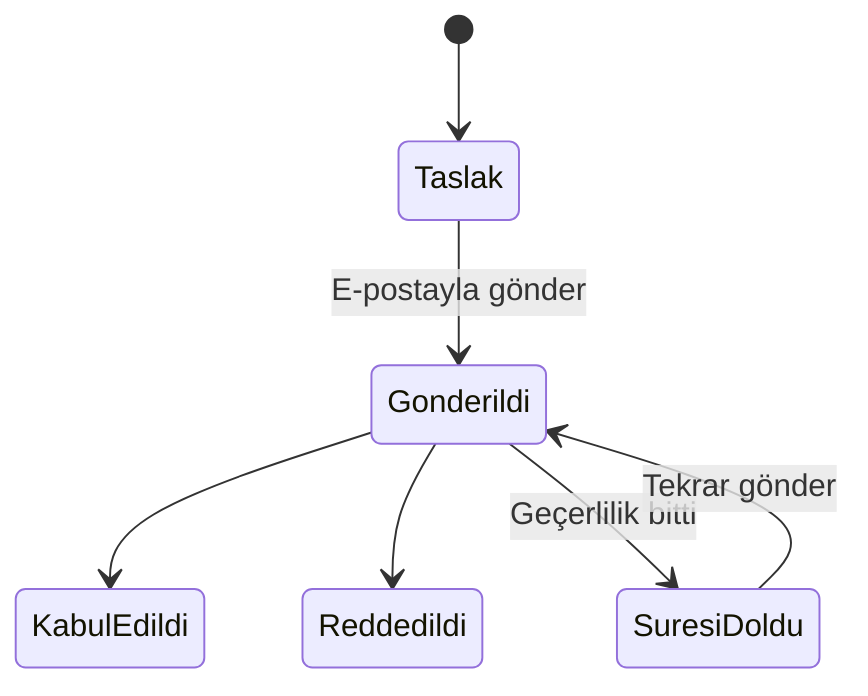
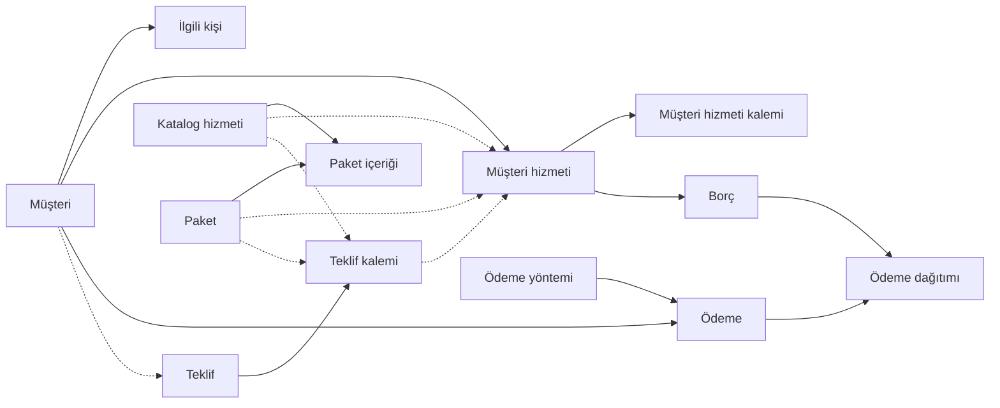

# Müşteri Takip Sistemi — Ürün Gereksinimleri (PRD)

Bu dosya iş kurallarının tek doğru kaynağıdır. Alan detayları `docs/DATA_MODEL.md`, görevler `docs/ROADMAP.md`, kararların gerekçeleri `docs/DECISIONS.md` dosyasındadır.

## Genel bakış ve tasarım ilkeleri

**En önemli ilke: Excel'den basit olmalı.** Sistemi yönetmek ayrı bir iş olmamalı. Her özellik şu testten geçer: "Bunu Excel'de yapmaktan daha kolay mı?" Geçemeyen özellik sadeleştirilir veya ertelenir.

Sistem; hosting, alan adı, bakım gibi yıllık hizmetleri müşteri bazında takip eder, teklif hazırlar, borçları otomatik oluşturur ve ödemeleri eşleştirir. Temel soru: "Bu ay kimden ne tahsil edeceğim ve kim gecikti?"

Proje tamamen Claude Code ile geliştirilecek. Çalışma kuralları `CLAUDE.md` dosyasındadır.

**Tasarım ilkeleri**

- **Esneklik:** Her müşteri farklıdır. Sistem varsayılanı önerir, kullanıcı her zaman değiştirebilir.
- **Geçmiş korunur:** Oluşmuş borçlar ve alınmış ödemeler iz bırakmadan değişmez. Değişiklikler sadece bundan sonrasını etkiler.
- **Sadelik:** Karmaşık kural motorları yerine tek net kural + elle düzenleme imkânı.
- **Katalog öneri, müşteri hizmeti gerçektir:** Katalogdaki fiyat ve bilgiler referanstır.

## Sözlük

Bu terimler proje boyunca, kodda ve dokümanlarda aynı anlamda kullanılır.

| Terim | Anlamı |
| --- | --- |
| Müşteri | Hizmet satılan kişi veya firma |
| İlgili kişi | Müşteride iletişime geçilen kişi; biri birincildir |
| Hizmet türü | Sabit liste: hosting, domain, bakım, SSL, kurumsal e-posta, lisans, diğer |
| Katalog | Panelden tanımlanan hizmet ve paketlerin listesi |
| Hosting planı | Hosting türündeki katalog kalemi (WHM package karşılığı) |
| Paket | Katalogdaki birden fazla hizmetin kendi fiyatı olan birleşimi |
| Müşteri hizmeti | Bir hizmet veya paketin bir müşteriye atanmış hali |
| Başlangıç / bitiş tarihi | Müşteri hizmetinin geçerli dönemi; yenileme borcu bitiş tarihine göre doğar |
| Teklif | Müşteriye veya potansiyel müşteriye gönderilen fiyat belgesi |
| Borç | Bir dönem için müşteriden tahsil edilecek tutar |
| Ödeme | Müşteriden gelen para |
| Ödeme yöntemi | Havale/EFT, kart gibi; panelden yönetilir |
| Alacak bakiyesi | Fazla ödemeden kalan, sonraki borçlara düşen tutar |

## Müşteriler ve ilgili kişiler

Her müşterinin benzersiz bir kısa adı ve en az bir, tam olarak bir birincil ilgili kişisi vardır.

| Alan | Zorunlu | Not |
| --- | --- | --- |
| Kısa ad | Evet | Benzersiz; listelerde görünen ad, örn. "Logi" |
| Ticari ünvan | Hayır | Örn. "Logitech Bilgisayar Ürünleri Ltd. Şti." |
| Vergi dairesi / no | Hayır | Ünvanla birlikte |
| Fatura adresi | Hayır |  |
| Notlar | Hayır | Serbest metin |
| pCloud klasörü | Hayır | Müşterinin pCloud klasörünün paylaşım bağlantısı; kartta pCloud simgesiyle yeni sekmede açılır. Yalnız pCloud adresleri kabul edilir |

Müşteri şahıs da olabilir; bu durumda ünvan boş kalır.

**İlgili kişi alanları:** ad soyad, görev, telefon, e-posta, birincil işareti.

**Birincil kişi kuralları**

- İlk eklenen kişi otomatik birincil olur.
- Başka biri birincil yapılınca öncekinin işareti kalkar.
- Birincil kişi silinmeden önce başka biri birincil yapılmalıdır; müşteri hiçbir zaman birincil kişisiz kalmaz.
- Rol (teknik, muhasebe vb.) tutulmaz.

**Görünüm**

- **Müşteri listesi:** Her müşteri tek satır; hizmet sayısı, açık borç ve en yakın yenileme tarihiyle. Örn. "Logi · 2 hizmet · 1.900 TL açık borç · 01.03.2027".
- **Müşteri kartı:** İlgili kişiler, müşteri hizmetleri (her biri ayrı satır, tarih, fiyat ve durumuyla), borçlar, ödemeler ve alacak bakiyesi. Farklı zamanlarda satılan hizmetler ayrı satırlarda görünür.

## Hizmet türleri ve katalog

Hizmet türleri sabittir; katalog kalemleri panelden istenildiği zaman eklenir. Tüm hizmetler yıllıktır ve alış fiyatı tutulmaz.

**Ortak alanlar (katalog):** hizmet adı, tür, referans satış fiyatı, notlar.

**Türe özel alanlar** (hepsi isteğe bağlı serbest metin):

| Tür | Katalogda | Müşteri hizmetinde |
| --- | --- | --- |
| Hosting | Sağlayıcı, disk alanı, aylık trafik, e-posta hesabı sayısı, veritabanı sayısı, alan adı/site sayısı | Bağlı alan adı, sunucu, cPanel kullanıcı adı |
| Domain | Alan adı sağlayıcı, uzantı | Alan adı |
| Bakım | Kapsam açıklaması | Bağlı alan adı / site |
| SSL | Sağlayıcı, sertifika tipi | Bağlı alan adı |
| Kurumsal e-posta | Sağlayıcı, kota | Bağlı alan adı, hesap sayısı |
| Lisans | Ürün adı, sağlayıcı | Lisans anahtarı (şifreli), adet |
| Diğer | Açıklama | Açıklama |

Disk alanı gibi değerler serbest girilir: "1000 MB", "Limitsiz", "50 GB SSD". Sunucu ve cPanel kullanıcı adı bilgi amaçlıdır; sunucudan çekilen hesaplarda eşleştirme için de kullanılır (bkz. Sunucu entegrasyonu).

Veritabanında periyot ay sayısı olarak tutulur (varsayılan 12) ama arayüzde gösterilmez.

## Paketler

Paket, katalogdaki birden fazla hizmetin birleşimidir ve içindeki hizmetlerin toplamından bağımsız kendi fiyatı vardır.

- Örnek: Kurumsal Paket = Linux Hosting 1000 MB + .com.tr Alan Adı + Bakım, yıllık 4.000 TL.
- Paket fiyatı da referanstır; müşteriye atanırken değiştirilebilir.
- Paketin tek başlangıç ve bitiş tarihi vardır; içindeki hizmetler bu tarihleri kullanır ve tek borç olarak tahsil edilir.

## Müşteriye atama

Katalogdan bir hizmet veya paket müşteriye atandığında bir müşteri hizmeti oluşur; bundan sonra gerçek bilgi budur.

**Fiyat**

- Katalog fiyatı atama sırasında öneri olarak gelir, değiştirilebilir.
- Müşteri hizmetindeki fiyat sonradan da güncellenebilir.
- Katalogda fiyat değişince mevcut müşteri kayıtları etkilenmez.
- Oluşmuş borçlar hiçbir fiyat değişikliğinden etkilenmez.

**Tarihler**

- Her müşteri hizmetinde tek bir başlangıç ve bitiş tarihi vardır; ayrı tahsilat tarihi tutulmaz.
- İki tarih de elle değiştirilebilir. Değişiklik oluşmuş borcun vadesini kaydırmaz; o borcun vadesi borcun kendisinden değiştirilir.

**Ücretsiz işareti:** Müşteri hizmetinde ücretsiz işareti bulunur (bkz. Borç oluşturma).

## Teklifler

Teklifler takiplidir: katalogdaki her hizmet ve paketin yanındaki "Teklif oluştur" butonuyla hazırlanır, sistemden e-postayla gönderilir ve kabulde müşteri hizmetine dönüşür.

Teklifte elle durum yönetimi yoktur: "gönderildi" e-posta gidince, "süresi doldu" geçerlilik bitince otomatik olur. Kullanıcının tek işi kabul veya red için tek tıklamadır. Taslak teklif düzenlenebilir ve silinebilir; gönderildikten sonra kilitlenir ve silinemez.

**Oluşturma**

- Alıcı mevcut müşteriden seçilir veya ad, firma, telefon, e-posta elle yazılır. Elle yazılan kişi müşteri listesine eklenmez.
- Fiyat katalogdan gelir, teklifte değiştirilebilir.
- Her teklife otomatik numara (örn. TKL-2026-0001), tarih ve geçerlilik süresi verilir (varsayılan 15 gün, ayarlardan).
- Teklif butona basılan hizmet veya paketle başlar; katalogdan başka hizmet ve paketler de eklenebilir (arşivlenmişler listelenmez). PDF'te kalem listesi ve toplam görünür; paketin içindeki hizmetler paket satırının altında yazar.
- Bir teklifte farklı para birimli kalemler olabilir; toplam para birimi başına ayrı gösterilir ("12.000 TL + 350 USD").
- Her teklif kalemi ücretsiz işaretlenebilir; PDF'te "Ücretsiz" olarak görünür, toplama katılmaz ve kabulde oluşan müşteri hizmeti de ücretsiz işaretli gelir.
- PDF'in başında Genel ayarlarda girilen firma bilgileri ve logo yer alır.

**Gönderim**

- PDF ekiyle e-posta gönderilir; alıcı varsayılan olarak teklifteki veya birincil kişinin e-postasıdır, değiştirilebilir.
- Kopyası kullanıcıya BCC ile gider (ayarlardaki teklif BCC adresi; boşsa bildirim adresi).
- Başarılı gönderimde durum otomatik "gönderildi" olur; tarih ve adres kaydedilir. Gönderim başarısız olursa durum değişmez.
- Gönderilmiş teklif aynı içerikle tekrar gönderilebilir; tekrar gönderimde geçerlilik bugünden yeniden başlar (süresi dolmuş teklif böylece yeniden geçerli olur).

**Kabul**

- Kabul ve red yalnız gönderilmiş ve süresi dolmamış teklifte yapılır.
- Kabul penceresinde başlangıç tarihi (varsayılan kabul günü) girilir; elle yazılan kişide yeni müşterinin kısa adı da bu pencerede görünür.
- Mevcut müşteride hizmet veya paket doğrudan atanır.
- Elle yazılan kişi için müşteri otomatik oluşturulur: kısa ad teklifteki firma adıyla (firma yoksa kişinin adıyla) dolu gelir ve kabul penceresinde değiştirilebilir; bu ad başka bir müşteride varsa kabul yapılmaz ve alanın altında hata görünür. Teklifteki kişi birincil ilgili kişi olur. Kısa ad sonradan müşteri kartından da değiştirilebilir.
- Teklif fiyatı müşteri hizmetine geçer.
- Her teklif kalemi için ayrı bir müşteri hizmeti oluşur; hepsi aynı başlangıç tarihiyle başlar. Alan adı gibi müşteriye özel bilgiler sonradan müşteri kartından girilir.
- Kabul bütün olarak yapılır: bir kalem oluşamazsa hiçbir kayıt oluşmaz.

**Red:** Teklif kapanır, hiçbir kayıt oluşmaz.

## Borç oluşturma ve ücretsiz hizmetler

Her dönem için bir borç doğar; tutar müşteri hizmetindeki fiyattır. Ödeme planları bilinçli olarak kullanılmaz.

**İlk dönem:** Hizmet veya paket müşteriye atandığında (teklif kabulü dahil) ilk yılın borcu doğar.

**Excel'den geçiş:** Atama ekranında "Bu dönemin borcu" seçimi bulunur. Varsayılan "Oluştur"dur; mevcut hizmetler girilirken "Oluşturma" seçilir ve o dönem için borç doğmaz, sonraki yenilemeden itibaren kural normal işler. Başlangıç tarihi olarak hizmetin şu anki döneminin başlangıcı girilir; bitişi bugüne veya daha öncesine düşen bir başlangıç tarihiyle atama "Başlangıç tarihi olarak hizmetin şu anki döneminin başlangıcını girin." uyarısıyla reddedilir. Böylece eski bir başlangıç tarihi yüzünden geçmiş dönemlerin borçları oluşmaz.

**Yenileme:** Bitiş tarihinden 30 gün önce yeni dönemin borcu otomatik oluşur; vadesi bitiş tarihidir. 30 gün ayarlardan değiştirilebilir.

**Dönem ilerlemesi:** Bitiş tarihi geldiğinde kayıttaki tarihler kendiliğinden bir yıl ilerler (01.03.2026 – 01.03.2027 → 01.03.2027 – 01.03.2028). Ödeme durumu bunu etkilemez; ödenmemiş borç gecikmiş olarak takip edilir. Ücretsiz kayıtlarda da aynı şekilde ilerler.

**İptal**

- Müşteri hizmetinde "İptal et" butonu vardır; iptal tarihi ve isteğe bağlı not girilir.
- İptal edilen kayıt pasif olur: tarihleri ilerlemez, yeni borç üretmez, özette görünmez. Geçmişi silinmez; gerekirse tekrar aktif edilir.
- **Henüz başlamamış dönemin ödenmemiş borcu:** İptal penceresinde "yaklaşan dönemin borcunu da iptal et" kutusu işaretli gelir; onaylanırsa iptal edilir.
- **Geçmiş dönemden kalan borç:** Hiçbir zaman otomatik iptal edilmez, takipte kalır. Pencerede bilgi olarak gösterilir (örn. "1.500 TL gecikmiş borç takipte kalacak").

**Ücretsiz hizmetler**

- Ücretsiz işaretli kayıtta borç doğmaz; hizmet ve bitiş uyarıları takip edilmeye devam eder.
- 30 gün kala özette "yeni döneme ücretsiz devam edecek mi?" sorusu yer alır.
- Kullanıcı bir şey yapmazsa hizmet ücretsiz devam eder. Sistem kendiliğinden ücretliye geçmez.
- İşaret dönem başlamadan kaldırılırsa yaklaşan dönemin borcu hemen oluşur.

**Elle düzenleme:** Her borcun tutarı ve vadesi değiştirilebilir, borç bölünebilir, gerekçeyle iptal edilebilir. Borçlar yalnızca kurallardan doğar; elle borç eklenmez (G-5B.3). Ödemesi alınmış borç sessizce değiştirilemez; önce ödeme eşleşmesi kaldırılır veya iptal ve düzeltme kaydı yapılır.

## Ödemeler ve alacak bakiyesi

Ödeme varsayılan olarak en eski vadeli borçtan başlayarak dağıtılır; kullanıcı dağıtımı kaydetmeden önce görür ve elle değiştirebilir.

**Ödeme kaydı iki alanlıdır:** müşteri ve tutar. Tarih bugün, yöntem son kullanılan olarak gelir; açıklama isteğe bağlıdır. Dağıtım otomatik yapılır, görmek ve değiştirmek isteğe bağlıdır. Ödeme yöntemleri panelden yönetilir.

**Dağıtım örneği:** Logi'nin 1.500 TL hosting ve 400 TL alan adı borcu var, 1.000 TL gönderdi. Otomatik dağıtımda 1.000 TL hosting'e düşer, 500 TL kalır. Kullanıcı isterse önce 400 TL'yi alan adına düşebilir; kalan 600 TL hosting'e düşer.

**Elle dağıtım:** Elle dağıtımda belirtilen tutarlar önce uygulanır; dağıtılmayan kısım aynı para birimindeki diğer açık borçlara en eski vadeden otomatik düşer; açık borç kalmazsa alacak bakiyesine eklenir. Aynı para biriminde açık borç ve alacak bakiyesi bir arada bulunmaz.

**Alacak bakiyesi**

- Açık borçları aşan tutar müşterinin alacak bakiyesine yazılır ve müşteri kartında görünür.
- Bakiye müşteri bazındadır; herhangi bir hizmetin borcuna düşebilir.
- Yeni borç doğduğunda bakiye otomatik olarak o borca düşer.
- Bakiyeden kapatılan borçlar özette ayrıca belirtilir.
- Kayıt ekranı sonucu gösterir: "1.900 TL borç kapatıldı, 600 TL alacak bakiyesine eklendi."

## Para birimleri

TL, USD ve EUR desteklenir; kur çevrimi veya kur hesabı yapılmaz.

- Katalogdaki her hizmet ve paketin bir para birimi vardır, varsayılan TL.
- Müşteri hizmeti katalogdaki para birimiyle gelir, değiştirilebilir. Teklif ve PDF de bu para birimini gösterir.
- Borç, müşteri hizmetinin para biriminde doğar.
- Ödeme bir para biriminde kaydedilir ve sadece aynı para birimindeki borçlara düşer. Para birimi müşterinin açık borcundan otomatik gelir; birden fazla varsa seçilir.
- Alacak bakiyesi para birimi başına ayrı tutulur.
- Toplamlar birbirine katılmadan ayrı gösterilir: "Toplam alacak: 12.000 TL + 350 USD".

## Sunucu entegrasyonu (Faz 8)

Panelden birden fazla sunucu bağlantısı tanımlanır: **WHM reseller** (paketler ve hesaplar) veya **cPanel** (tek hesap, çok alan adlı; ana ve addon alan adlarının her biri ayrı host). Kimlik şifre değil API token'dır, şifreli saklanır. Sistem sunucudan yalnız okur; hesap açma, askıya alma ve kota uygulama (sınırı zorlama) yoktur. Kullanım bilgisinin okunup gösterilmesi ve uyarılması Faz 9'dadır (aşağıdaki bölüm).

**"Sunucudan çek"** yalnız elle çalışır (zamanlayıcıda iş yok):

- **Paketler (WHM):** Her WHM paketi hosting türünde bir katalog hizmeti olur; disk, trafik, e-posta, veritabanı ve site sayısı katalog bilgilerine dolar. WHM'de fiyat olmadığı için yeni paketin fiyatı çekme penceresinde girilir. Sonraki çekmelerde yalnız bu bilgiler güncellenir; ad ve fiyat değişmez.
- **Hesaplar:** Her WHM hesabı (cPanel'de her alan adı) için müşteri ve müşteri hizmeti oluşur: kısa ad, birincil ilgili kişi adı ve kalemdeki alan adı çekme penceresinde seçilen addır (varsayılan ana alan adı; hesabın alan adlarından biri ya da elle yazılan), e-postası WHM iletişim e-postasıdır (cPanel alan adlarında boş). Dönem, WHM açılış tarihinin bugünü kapsayan yıldönümüdür (cPanel'de tarih yoktur, çekme penceresinde tek başlangıç tarihi girilir); "Bu dönemin borcu: Oluşturma" uygulanır, yani hiçbir borç doğmaz, yenileme normal kuralla işler. cPanel alan adları, bağlantıya seçilen hosting hizmetiyle atanır.
- **İstenmeyen hesap:** Çekme penceresinde yeni hesaplar listeden çıkarılabilir; çıkarılan hesap kaydedilmez, sonraki çekmede yine listelenir. Paketler çıkarılamaz.
- **Çiftleme olmaz:** Çekme tekrarlanabilir; bağlı kayıt varsa hiçbir şey oluşmaz. Aynı alan adı veya cPanel kullanıcı adıyla elle girilmiş bir hosting kalemi varsa yeni kayıt açılmaz, o kaleme bağlanır. Kısa ad zaten bir müşteride varsa hizmet o müşteriye eklenir.
- **Askıdaki hesaplar** aktarılmaz, sonuçta sayılır. Sunucudan kaybolan bağlı hesap yalnız raporlanır; hizmet otomatik iptal edilmez.
- Bir hesapta hata olursa diğerleri devam eder; sorunlu hesaplar sonuçta adıyla görünür.

## Sunucu kullanımı ve kota uyarıları (Faz 9)

Sunucuya bağlı her hosting hesabının kullanımı sunucudan **yalnız okunur**, saklanır ve gösterilir. Kota uygulama, sınır koyma ve askıya alma yoktur (parkta). Faz 8'deki "zamanlayıcıda iş yok" kuralı yalnız bu kullanım verisi için kalkar; "Sunucudan çek" yine yalnız elle çalışır.

- **Okunan veri:** Disk ve aylık trafik (kullanılan / sınır), inode, e-posta hesabı, yönlendirici, otomatik yanıtlayıcı, e-posta listesi, FTP hesabı, veritabanı, ek / alt / park alan adı sayıları ve sınırları; her e-posta adresinin kullanılan alanı, kotası ve askı durumu; her veritabanının adı ve boyutu. Sınır yoksa "Limitsiz".
- **cPanel türü:** Bir cPanel hesabının alan adları ayrı müşteridir. Disk, trafik ve sayaçlar hesap geneli olduğu için her alan adı hizmetinde "Hesap geneli" notuyla görünür; e-posta kutuları yalnız o alan adınınkiler olarak süzülür.
- **Yenileme:** Bağlı ve aktif hizmeti olan hesaplar zamanlayıcıyla Genel ayarlardaki aralıkta bir yenilenir (varsayılan 1 saat; en az 15 dakika, en çok 30 gün) (henüz yenilenmediyse yenilenir; atlanan çalışma sonraki çalışmada tamamlanır). Kullanım penceresinde "Şimdi yenile" tek hesabı hemen yeniler. Sunucuya ulaşılamazsa son başarılı veri korunur ve hata gösterilir.
- **Eşik:** Ayarlardaki "Kullanım uyarı eşiği" (varsayılan %90). Eşiğin altı renksiz; eşik ile %99 arası "Dolmak üzere" (amber); %100 ve üstü "Dolu" (kırmızı). Limitsiz kaynak uyarı vermez. Yüzde ve durum saklanmaz, hesaplanır.
- **Uyarılar:** Disk, trafik, her e-posta kutusu ve sayaçlar (ör. 10/10 e-posta hesabı) eşiğe göre değerlendirilir. Eşiği yeni aşan her şey yenilemeden sonra **tek e-postada** bildirim adresine gider; aynı aşım için ikinci e-posta gitmez, kullanım eşiğin altına inip yeniden aşarsa yeniden uyarılır. E-posta gönderilemezse sonraki çalışmada yeniden denenir. Özet e-postasına "Kotası dolmak üzere olanlar" bölümü eklenir (şu an eşiğin üstünde olan her şey); "Bugün" yapılacaklarına kota satırları eklenir.
- **Bayi toplamı (WHM):** Her WHM sunucusunun bayi hesabının toplam disk, trafik ve hesap sayısı, bayi limitleriyle birlikte aynı aralıkta okunur. Limitler okunabiliyorsa eşik aynı kurallarla uygulanır ve aşılınca hesap uyarılarıyla aynı e-posta, özet ve Bugün satırı ("Sunucu: X") çıkar. Limit okunamıyorsa yalnız toplam gösterilir; yüzde ve uyarı olmaz. cPanel bağlantısında bayi toplamı yoktur.
- **Hesabın tüm alan adları (WHM):** Bir hosting hesabına bağlı ana, ek ve park alan adları kullanım yenilemesiyle okunur ve saklanır (alt alan adları yok). Müşteri kartında hizmet satırı kısa kalır ("logi.com.tr +3 alan adı"); tam liste hizmet düzenleme ve Kullanım pencerelerindedir. Ctrl+K ve müşteri araması bu alan adlarıyla da müşteriyi bulur. cPanel bağlantısında yoktur (her alan adı zaten ayrı hizmettir).
- **Sunucu kullanım penceresi (WHM):** Sunucular ekranında "Kullanım" sütununa tıklanınca sunucunun bayi toplamları (limitler okunabiliyorsa yüzdeyle), hesaplara tahsis edilen disk ve trafik toplamı ve sunucudaki bütün hesaplar (müşteriye bağlı olmayanlar dahil) disk, trafik, paket, askı durumu ve müşteriyle listelenir. Hesap listesi bayi toplamıyla aynı aralıkta okunur; hesap başına e-posta uyarısı yoktur.
- **Cloudflare göstergesi (G-9.10):** Hizmetin alan adının NS kaydı Cloudflare'deyse (`*.ns.cloudflare.com`) müşteri kartının hizmet satırında alan adının yanında Cloudflare logosu görünür; zamanlayıcı bunu 24 saatte bir kontrol eder. Bağlı değilse veya henüz kontrol edilmediyse hiçbir şey görünmez; başka ekranda gösterim yoktur (U-28, T-169).
- **Gösterim:** Normal durumda ekran değişmez (istisna odaklı). Sorun olan hesapta müşteri kartındaki hizmet satırında rozet, "Bugün"de satır ve Sunucular ekranında özet görünür; ayrıntı ayrı, salt okunur bir "Kullanım" penceresindedir (`docs/UI.md` §Kullanım penceresi).
- Arşivli müşteri ve iptal edilmiş hizmet uyarı, özet ve Bugün'de görünmez.

## Gecikmiş borçlar ve özet e-postası

Vadesi geçip ödenmeyen borç "gecikmiş" olarak işaretlenir ve özette kaç gün geciktiğiyle listelenir. Faiz, gecikme bedeli veya askıya alma yoktur; askıya alma ayrı bir öneri olarak park edildi.

**Gecikme kuralı:** Vade günü boyunca borç açık sayılır. Vadenin ertesi gününden itibaren ödenmemiş tutar kalıyorsa borç gecikmiş olur ve gecikme günü oradan sayılır (vade 01.03 → 02.03'te "1 gün gecikti"). Gün hesabı Europe/Istanbul saatine göre yapılır.

**Özet e-postası** ayarlardan seçilen sıklıkta (Günlük / Aylık, varsayılan ayın 15'i, 09:00) gider; tüm bölümler boşsa gönderilmez. Bölümleri:

1. Son özetten bu yana oluşan borçlar (bakiyeden kapatılanlar ayrıca belirtilir)
2. Ücretsiz devam kararı bekleyenler
3. Vadesi geçmiş borçlar

Her satırda ilgili kayda bağlantı vardır.

**WhatsApp ile hatırlatma (G-5B.4):** Müşterilere en kolay ulaşılan yol çoğu zaman WhatsApp'tır. Açık her borç için (yenileme borcu olması ya da gecikmiş olması aranmaz) Bugün'deki borç satırında ve müşteri kartının Açık borçlar satırında "WhatsApp" bağlantısı bulunur; tıklanınca birincil kişinin sohbeti hazır yazılmış borç mesajıyla yeni sekmede açılır. Sistem mesajı kendisi göndermez ve gönderildiğini bilmez, bu yüzden hiçbir kayıt tutulmaz; kullanıcı mesajı okuyup WhatsApp'ta kendisi gönderir. Mesaj kişinin adını, hizmetin alan adını ve borç açıklamasını, kalan tutarı, vadeyi (gecikmişse "geçmiştir", değilse "son günü"), varsa firma adı ve IBAN'ı içerir. Birincil kişinin telefonu yoksa ya da geçerli bir numaraya çevrilemiyorsa, borç açık değilse ve müşteri arşivliyse bağlantı çıkmaz. IBAN, Genel ayarlardaki firma bilgilerinde tutulur (TR ile başlayan 26 karakter).

## Kullanıcılar ve yetkiler (Faz 12)

Uygulamayı 1 yönetici ve 2-3 yazılımcı kullanır. İki yerleşik rol vardır (`Yönetici`, `Yazılımcı`); yönetici Ayarlar > Roller ekranından yeni rol ekler ve her rolün yetkilerini kutularla ayarlar (kişi başına izin yok, izinler role bağlıdır). `Yönetici` rolü kilitlidir ve her zaman tüm yetkilere sahiptir. Rol-izin eşlemesi veritabanındadır; Yazılımcı varsayılanı yalnız ilk kurulumda yazılır.

| Alan | Yönetici | Yazılımcı |
| --- | --- | --- |
| Müşteri ve ilgili kişi ekleme/düzenleme, notlar | Evet | Evet |
| Müşteri kartında hizmetleri görme (ad, alan adı, sunucu, bitiş tarihi) | Evet | Evet, fiyatsız |
| Hizmet atama, düzenleme, iptal, yeniden etkinleştirme | Evet | Hayır (fiyat ve borç içerir; ileride genişletilebilir) |
| Bugün, Açık borçlar, Ödemeler, ödeme alma, borç işlemleri | Evet | Hayır |
| Teklifler, katalog, paketler | Evet | Hayır |
| Genel ayarlar, ödeme yöntemleri, sunucular | Evet | Hayır |
| Kullanıcılar (davet, rol, pasifleştirme) | Evet | Hayır |
| İşler: oluşturma, atama, bitirme (Faz 13) | Evet | Evet |
| Bugün sayfası | Evet, tamamı | Evet, parasız: yalnız bana atanan işler ve kota uyarıları |
| Takvim: etkinlik ekleme ve görme (Faz 15) | Evet | Evet, parasız: borç vadesi, ödeme ve teklif kayıtları görünmez |

**Kurallar**

- **Yazılımcı parayı hiç görmez:** borç, ödeme, teklif, fiyat ve bakiye hiçbir ekranda, listede veya aramada görünmez. Yetki yalnız arayüzde gizlenerek değil, rota, ekran ve işlem düzeyinde sunucuda zorlanır.
- **Davetle hesap:** Yönetici ad, e-posta ve rol girer; kişiye 72 saat geçerli imzalı bir bağlantı e-postayla gider (senkron), şifresini kendisi belirler. Yeniden gönderilen davet öncekini geçersiz kılar. Şifresi belirlenmemiş kullanıcı giriş yapamaz.
- **Silme ve pasifleştirme:** Para kaydında adı geçen (ödeme kaydeden, borç iptal eden/düzenleyen, teklif kabul eden) kullanıcı silinmez; pasifleştirilir. Hiç işlem yapmamış kullanıcı silinebilir. Pasif kullanıcı giriş yapamaz, açık oturumu kapanır.
- **Düzenleme:** Yönetici kullanıcının adını ve rolünü değiştirir; e-posta adresi değişmez.
- **Roller:** Yönetici yeni rol ekler, özel rolün adını ve yetkilerini değiştirir; Yazılımcı'nın yetkilerini değiştirir (adı sabit). Yönetici rolü değişmez. Yönetmek görmeyi gerektirir: `money.manage` `money.view`'ı, `services.manage` `services.view`'ı kendiliğinden getirir. Yerleşik roller ve kullanıcısı olan rol silinmez.
- **Yönetici güvencesi:** Yönetici kendini pasifleştiremez, silemez ya da rolünü düşüremez; son etkin yönetici pasifleştirilemez, silinemez ya da rolü düşürülemez.
- **Kim yaptı:** Ödemeyi kaydeden, borcu iptal eden/düzenleyen ve teklifi kabul eden kullanıcı saklanır ve kayıtta görünür. Zamanlanmış işlerin oluşturduğu kayıtlarda boştur ("Sistem").
- **Mevcut hesap:** `.env`'den oluşan ilk hesap (T-28) yönetici olur.

## İşler (Faz 13)

Müşteri talepleri ve ekip içi yapılacaklar WhatsApp'ta kaybolmasın diye tek bir basit iş listesi vardır. Öncelik, etiket, yorum, alt iş, tekrarlanan iş ve dosya eki **yoktur**.

**Alanlar:** başlık (zorunlu), müşteri (isteğe bağlı; müşterisiz iç iş olabilir), atanan kişi (zorunlu; varsayılan işi oluşturan), bitiş tarihi (isteğe bağlı), not (isteğe bağlı).

**Kurallar**

- **Durum saklanmaz, hesaplanır:** Açık (`completed_at` boş) veya Bitti. Gecikmiş: açık ve bitiş tarihi bugünden önce. "Bugün": açık ve bitiş tarihi bugün. Bitirilen iş yeniden açılabilir.
- **Yetki:** `tasks.manage` izni olan herkes (Yönetici ve Yazılımcı varsayılanı) iş oluşturur, her işi düzenler, başkasına atar, bitirir, yeniden açar ve siler. Yetki Roller ekranından değişir.
- **E-posta:** İş başkasına atandığında (yeni iş ya da atanan değişince) atanan kişiye senkron e-posta gider; kendine atamada gitmez. E-posta gönderilemezse iş yine kaydedilir ve kullanıcıya uyarı gösterilir. E-postada para bilgisi bulunmaz.
- **Kim yaptı:** Oluşturan ve bitiren kullanıcı saklanır ve gösterilir (T-159 ile aynı yöntem).
- **Geçmiş korunur:** İşi olan müşteri silinmez, arşivlenir. İşi olan (atanmış, oluşturmuş ya da bitirmiş) kullanıcı silinmez, pasifleştirilir.
- **Pasif kullanıcı:** Yeni atamada seçilemez; açık işleri adının yanında "(pasif)" ile görünür.
- **Arşivlenmiş müşterinin işleri** listede kalır, müşteri adı soluk ve "Arşiv" rozetiyle görünür; arşivli müşteriye yeni iş açılamaz.
- **Mesajdan iş (Faz 17, U-40, U-41):** WhatsApp'tan gelen bir mesaj kopyalanıp panelde yapıştırılınca (`tasks.manage` izni olan kullanıcı, yazı kutusunun dışında) "Yeni iş" penceresi açılır; yeni alan ya da tablo yoktur, kayıt mevcut iş oluşturma kuralıyla yapılır.
  - **Not:** Yapıştırılan metin yalnız nota, temizlenerek yazılır: satır başındaki WhatsApp öneki (`[28.10.2026 14:32] Ad:` ve `[14:32, 28.10.2026] Ad:`) atılır, satır sonu boşlukları kırpılır, art arda boş satırlar teke iner; birden çok kişi konuşuyorsa konuşan değiştiği satırın başına `Ad:` yazılır, tek kişiyse ad yazılmaz; en çok 5000 karakter.
  - **Başlık** boş gelir, kullanıcı yazar (zorunlu); **müşteri** tahmin edilmez, boş gelir.
  - Pencere açıkken Not alanına yapıştırılan metin de aynı kurallarla temizlenip notun altına eklenir.
  - Atanan kişi, e-posta ve yetki kuralları olduğu gibi geçerlidir. Temizleme hiçbir kayıt yazmaz; kayıt yalnız kullanıcı "Kaydet"e basınca (ya da `Enter`) oluşur.
- **Görünüm:** İşler ekranı (varsayılan: bana atanan, açık), müşteri kartında "İşler" bölümü ve Bugün'de "Bana atanan işler" bölümü. Süzgeçler: kişi (Bana atanan / Herkes), durum (Açık / Bitti), müşteri, gecikmiş.
- **Bugün herkesin açılış sayfasıdır:** Dört sayı, borç satırları ve ücretsiz kararlar `money.view`; kota uyarıları `services.view`; "Bana atanan işler" `tasks.manage` ister. İzni olmayan bölümün verisi hiç okunmaz. Zamanlayıcı uyarısı `settings.manage` ister.
- Özet e-postası (günlük özet) işleri içermez.

## Takvim (Faz 15)

Gün, hafta ve ay görünümlü tek bir takvim sayfası vardır. Tasarım: [takvim taslağı](https://claude.ai/artifact/S3s1gtvjgj87edJ1p4Qtqq); uygulama taslağın birebir aynısıdır. Takvim **üç kaynağı** tek ekranda birleştirir; yalnız birincisi yeni bir kayıttır.

1. **Elle girilen etkinlikler** (`calendar_events`): toplantı, arama, teslim. Saatli ya da tüm gün. Alanlar: başlık (zorunlu), tarih (zorunlu), başlangıç ve bitiş saati (tüm günde boş), müşteri (isteğe bağlı), yer, katılanlar (kullanıcılar), hatırlatma, tekrar, not.
2. **Sistemdeki tarihler** (saklanmaz, hesaplanır; tüm gün olarak görünür): hizmet ve alan adı bitişi, açık borç vadesi, gönderilmiş teklifin geçerlilik sonu, açık işin bitiş tarihi. Tıklayınca kaydın kendi penceresi açılır; takvimden değiştirilmez.
3. **Kayda geçen olaylar** (geçmiş, değiştirilemez): ödeme alındı (`payments.created_at`), teklif gönderildi (`quotes.sent_at`), iş bitirildi (`tasks.completed_at`) ve Faz 16'dan site kapandı / açıldı ile SSL / alan adı süresi yaklaşıyor uyarıları.

**Kurallar**

- **Yetki:** Herkes takvimi görür ve etkinlik ekler, düzenler, siler (`calendar.manage`, iki rolde varsayılan açık; sayfanın kendisi izin istemez). Yazılımcı para kayıtlarını (borç vadesi, ödeme, teklif) takvimde de görmez; bu kaynakların verisi hiç okunmaz.
- **Saatler** Europe/Istanbul; tarih gg.aa.yyyy, saat 24 saatlik. Bitiş, başlangıçtan önce olamaz. Tüm gün etkinlikte saat alanları boştur.
- **Tekrar:** Tekrarlamaz · Her hafta · Her ay; bitiş tarihi isteğe bağlı. Tekrarlar saklanmaz, görünür aralık için açılır. Ayın 29-31'inde başlayan aylık etkinlik kısa aylarda ayın son günü görünür. Düzenleme ve silme bütün seriye uygulanır; tek bir tekrar ayrı düzenlenmez.
- **Katılanlar:** Etkin kullanıcılar eklenebilir. Katılan kişiye senkron davet e-postası gider; kişi kendini eklediğinde gitmez; gönderilemezse etkinlik yine kaydedilir ve uyarı gösterilir. Etkinlik katılanın takviminde de görünür.
- **Hatırlatma:** Başlangıçtan önce seçilen süre (15 dk, 30 dk, 1 saat, 1 gün) e-postayla bildirilir. Zamanlanmış iş en sık 15 dakikada bir çalışır; e-posta en çok 15 dakika geç gelir, her tekrar için bir kez gider, başlangıcı geçmiş etkinliğe gitmez. Hatırlatma tüm katılanlara ve etkinliği oluşturana gider.
- **Müşteriye bağlı etkinlik** müşteri kartında da listelenir. Etkinliği olan müşteri silinmez, arşivlenir; etkinliği oluşturan kullanıcı silinmez, pasifleştirilir.
- **Süzgeç:** Kategori çipleri (Etkinlikler, İşler, Hizmet bitişleri, Borç vadeleri, Ödemeler, Teklifler, Uyarılar) ve "Yalnız benimkiler" (oluşturduğum, katıldığım etkinlikler ve bana atanan işler).
- **Kapsam dışı:** dış takvimlerle (Google, Outlook) eşitleme, davetliden yanıt (kabul/red), tek tekrarı ayrı düzenleme, kaynak ve oda yönetimi.

## Alan adı ve site araçları (Faz 16)

Küçük, tek amaçlı kontroller; müşteri hizmetlerinin alan adları üzerinde çalışır ve panelden tıklanarak kullanılır. Menüde ayrı sayfaları yoktur: Ctrl+K'ya alan adı yazınca "Alan adını kontrol et" satırı, müşteri kartındaki alan adı satırında "Kontrol et" bulunur ve ikisi de aynı pencereyi açar (sekmeler: DNS · SSL · WHOIS · E-posta). `services.view` izni gerekir (yazılımcı kullanır).

- **DNS:** A, AAAA, MX, NS, TXT ve CNAME kayıtları anlık sorulur, saklanmaz.
- **SSL denetleyici:** Sertifikanın bitiş tarihi günde bir arka planda okunur ve saklanır; 14 gün içinde bitenler Bugün'de ve takvimde uyarı olur.
- **WHOIS:** Alan adının kayıt bitiş tarihi ve kayıt şirketi RDAP ile (`.tr` için TRABİS WHOIS ile) okunur ve saklanır; hizmetin bitiş tarihiyle 7 günden fazla fark varsa uyarı satırı gösterilir. Okunamayan sorgu "Okunamadı" yazar, hata olarak ele alınmaz.
- **Hosting–alan adı eşleşmesi:** Hosting kaleminin alan adının A kaydı, bağlı sunucunun IP adresleriyle karşılaştırılır; eşleşmeyenler Bugün'de "Başka yere taşınmış görünen hostingler" bölümünde (`services.view`) çıkar. Cloudflare'e bağlı alan adlarında sonuç "bilinmiyor" kalır, yanlış alarm verilmez.
- **Site taraması ve olay kaydı:** Aktif hosting alan adlarına 15 dakikada bir HTTP isteği atılır. Ardışık 2 hata "site kapandı" olayını açar; ilk başarılı yanıt olayı kapatır ("açıldı", süre hesaplanır). Anında e-posta gitmez; olay Bugün'de "Kapalı siteler" bölümünde, takvimde ve günlük özet e-postasında görünür.
- **E-posta kayıtları:** SPF, DKIM (`default._domainkey`, cPanel varsayılanı) ve DMARC kayıtları denetlenir; eksik ya da hatalı her kayıt için tek cümlelik Türkçe çözüm önerisi verilir.
- **Kurallar:** Dış sorgu zaman aşımına uğrarsa ya da okunamazsa sonuç "bilinmiyor" olur; hiçbir kontrol borç, hizmet veya ödeme kaydını değiştirmez. Arka plan işleri idempotenttir ve süre bütçelidir (yapılmamış olanı sonraki çalışmada yapar). Yeni Composer paketi eklenmez.

## Claude erişimi (Faz 18)

Kullanıcı kendi bilgisayarındaki Claude Code'dan canlı uygulamaya bağlanıp soru sorar ("bu ay vadesi gelen borçlar ne?", "logi.com.tr kimin?") ve sınırlı işlem yapar. Uygulama `/mcp` adresinde bir MCP sunucusu açar; Claude bu sunucudaki **araçları** çağırır. Araçlar arayüzle aynı Action'ları çağırır, yani iş kuralları ve yetkiler arayüzdekiyle birebir aynıdır. Hostingde SSH olmadığından bağlantı yalnız HTTPS üzerindendir; sunucuda komut çalıştırma, dosya ya da veritabanına doğrudan erişim **yoktur**.

**Token**

- Her kullanıcı Profil'deki "Claude erişimi" bölümünden kendine token üretir: ad (örn. "Ev bilgisayarı") ve yetki (**Yalnız okuma** ya da **Okuma ve yazma**). Token düz metin olarak yalnız bir kez gösterilir; veritabanında yalnız özeti (hash) saklanır.
- Token 90 gün geçerlidir; süresi dolan yenisiyle değiştirilir. Listede adı, yetkisi, oluşturulma ve son kullanım zamanı, bitiş tarihi görünür; kullanıcı kendi token'ını tek tıkla iptal eder, başkasınınkini göremez ve iptal edemez.
- Pasifleştirilen kullanıcının bütün token'ları silinir; pasif kullanıcının token'ı çalışmaz.
- Panel oturumu (tarayıcı çerezi) MCP'ye giriş açmaz; yalnız token geçerlidir. Token başına dakikada en çok 60 istek yapılır.

**Yetki**

- Token kullanıcının **rolünün izinleriyle** çalışır: izni olmayan araç Claude'a hiç listelenmez ve çağrılamaz. Yazılımcı parayı burada da görmez.
- Yazma araçları yalnız "Okuma ve yazma" token'ında bulunur.
- **Silme, iptal, arşivleme ve geri alma aracı yoktur**; bunlar yalnız panelden yapılır.

**Araçlar**

- **Okuma:** Bugün özeti (dört sayı ve yapılacaklar), müşteri arama (ad, alan adı, telefon; arşivliler istenirse), müşteri kartı (hizmetler, ilgili kişiler, açık borç), borç listesi (açık / gecikmiş, müşteri, tarih aralığı; para birimi başına toplam), ödeme listesi (tarih aralığı, müşteri), iş listesi (açık / bana atanan), takvim (en çok 92 günlük aralık). Listeler en çok 50 satır döner.
- **Yazma (Okuma ve yazma token'ı):** iş ekleme, iş bitirme, ödeme kaydetme (otomatik dağıtım; elle dağıtım yok). Kayıtta "kim yaptı" token sahibidir; atama e-postası ve diğer kurallar paneldeki gibi işler.

**Kurallar**

- Araç yanıtı yalnız gereken alanları içerir; şifre, token, sunucu API anahtarı gibi gizli bilgiler hiçbir yanıtta bulunmaz. Para tutarları para birimi başına ayrı verilir, toplanmaz.
- Her araç çağrısı ayrı bir günlük dosyasına yazılır (kullanıcı, token adı, araç, zaman); yazma araçlarında girilen değerler de yazılır.
- **Veri çıkışı:** Araç yanıtındaki müşteri bilgileri kullanıcının Claude hesabına (Anthropic) gider. Bu, token'ı üreten kullanıcının bilinçli seçimidir; Profil'deki bölüm bunu tek cümleyle belirtir.
- **Kapsam dışı:** claude.ai web/telefon bağlayıcısı (OAuth gerektirir), sunucuda komut ya da dosya işlemi, rapor dışa aktarma, silme/iptal araçları.

## Veri modeli

Sistem 13 tablodan oluşur; bu bölüm tabloları ve aralarındaki ilişkiyi gösterir, alan detayları ayrı sekmededir. Parantez içindeki adlar kodda kullanılacak adlardır.

Alan detayları: `docs/DATA_MODEL.md`

Düz ok "sahip olur", kesikli ok "isteğe bağlı bağlantı" demektir.

| Tablo | Kod adı | Ne tutar |
| --- | --- | --- |
| Müşteri | customers | Kısa ad, ünvan, vergi ve adres bilgileri |
| İlgili kişi | contacts | Müşterinin kişileri; biri birincil |
| Katalog hizmeti | catalog\_services | Tür, ad, referans fiyat, para birimi, türe özel bilgiler |
| Paket | packages | Ad, kendi fiyatı, para birimi |
| Paket içeriği | package\_items | Hangi paketin içinde hangi katalog hizmetleri var |
| Müşteri hizmeti | customer\_services | Müşteriye satılan hizmet veya paket: fiyat, para birimi, başlangıç/bitiş, ücretsiz, durum, iptal bilgisi |
| Müşteri hizmeti kalemi | customer\_service\_items | Müşteriye özel bilgiler: alan adı, sunucu, cPanel kullanıcı adı, lisans anahtarı vb. Pakette her iç hizmet için bir kalem |
| Teklif | quotes | Numara, alıcı (müşteri veya elle yazılan kişi), durum, tarihler, gönderim bilgisi |
| Teklif kalemi | quote\_items | Teklifteki her hizmet veya paket: ad, fiyat, para birimi, ücretsiz işareti |
| Borç | charges | Müşteri hizmeti (eski elle borçlarda boş; yeni borçta hep dolu), tutar, para birimi, vade, dönem, durum |
| Ödeme | payments | Müşteri, tutar, para birimi, tarih, yöntem, açıklama |
| Ödeme dağıtımı | payment\_allocations | Hangi ödemenin ne kadarı hangi borca düştü |
| Ödeme yöntemi | payment\_methods | Havale/EFT, kart gibi |

Sunucu bağlantıları için `servers` tablosu (Faz 8), kullanım önbelleği için `account_usages` ve `mailboxes` tabloları (Faz 9) ve ayrıca ayarlar (30 gün, özet sıklığı, ayın günü ve saati, teklif geçerliliği, BCC adresi) ve Laravel'in kendi kullanıcı tablosu bulunur.

**Bilinçli tasarım seçimleri**

- **Alacak bakiyesi ayrı tabloda tutulmaz;** ödemeler ile dağıtımların farkından, para birimi başına hesaplanır. Böylece bakiye hiçbir zaman kayıtlarla çelişemez.
- **Türe özel bilgiler tek esnek alanda tutulur.** Disk alanı, sağlayıcı gibi bilgilerin hepsi serbest metin olduğu için her türe ayrı tablo açmak yerine tek alanda saklanır; hangi türün hangi bilgileri alacağı kodda tanımlanır.
- **Müşteri hizmeti satış anının kopyasını tutar.** Ad, fiyat ve para birimi katalogdan kopyalanır; katalog değişse de müşteri hizmeti etkilenmez.

**Silme ve arşiv**

- Hiç borcu veya ödemesi olmayan kayıtlar gerçekten silinebilir.
- Borcu veya ödemesi olan kayıtlar silinmez, arşivlenir: listelerden ve özetten kaybolur, geçmişiyle sistemde durur, arşivden geri alınabilir. Müşteri hizmetlerinde bunun karşılığı iptaldir.
- Yanlış girilmiş ödeme silinebilir; dağıtımları geri alınır ve kapattığı borçlar tekrar açık hale gelir.

## Teknik kararlar ve Claude Code ile çalışma

Proje Laravel 13 ve PHP 8.3+ ile, tamamen Claude Code tarafından geliştirilecek.

| Konu | Karar | Durum |
| --- | --- | --- |
| Framework | Laravel 13 (Laravel 11 güvenlik desteği Mart 2026'da bitti) | Kararlaştı |
| PHP | 8.3 veya üzeri; hostingde 8.3 doğrulandı | Kararlaştı |
| Arayüz | Filament 5 (hazır tablo, form ve panel bileşenleri; ileride müşteri paneli için ikinci panel) | Kararlaştı |
| Model stili | PHP Attribute'ları; tüm projede tek stil | Kararlaştı |
| Tutarlar | Kuruş cinsinden tam sayı; float kullanılmaz | Kararlaştı |
| Sabit listeler | PHP backed enum | Kararlaştı |
| Test ve kalite | Pest, Pint, Larastan, GitHub Actions | Kararlaştı |
| AI araçları | Laravel Boost (sürüme özel dokümantasyon) | Kararlaştı |
| Hassas veri | Lisans anahtarı şifreli saklanır | Kararlaştı |
| Veritabanı | MySQL 8.0 (hostingde 8.0.45); yerelde Docker'da da MySQL 8.0 sabitlenir; karakter seti utf8mb4, tablo motoru InnoDB'ye sabit (hosting varsayılanı MyISAM); kod MySQL 8.4 ile de uyumlu kalır | Kararlaştı |
| PDF, kuyruk, zamanlayıcı | Reseller hosting (cPanel), cron en sık 15 dakikada bir: PDF için dompdf (saf PHP, Türkçe için DejaVu font); kuyruk yok, teklif e-postası anında gönderilir; zamanlayıcı */15 cron ile çalışır ve görevler tekrar çalışmaya dayanıklıdır; Redis yok, önbellek ve oturum database/dosya | Kararlaştı |
| E-posta gönderimi | cPanel e-posta hesabı SMTP (örn. teklif@firmaniz.com), kuyruksuz anında gönderim; alan adında SPF ve DKIM açık olmalı | Kararlaştı |

**Karar yetkisi:** Sadece kodun içini ilgilendiren ve işleyişe etkisi olmayan kararları Claude verir ve gerekçesiyle kaydeder; işe veya altyapıya dokunan kararlar kullanıcıya sorulur.

**Yayına alma (SSH ve Composer yok, PHP 8.3 seçilebilir)**

- Kod GitHub'da tutulur. Her yayın için GitHub Actions testleri çalıştırır, Composer bağımlılıklarını (`vendor`) ve arayüz dosyalarını hazırlar; paket değiştiyse `main` dalına ekler. Hosting `main`'i cPanel'in Git ekranından çeker. Sunucuda Composer gerekmez.
- Çektikten sonra kullanıcı tarayıcıda gizli anahtarlı yayın adresini bir kez açar; veritabanı güncellemeleri (migration) ve önbellek yenileme hemen çalışır. SSH ve yayın için cron gerekmez.
- Cron 15 dakikada bir çalıştığı için zamanlanmış işler "tam dakikada çalış" yerine "henüz yapılmadıysa yap" mantığıyla yazılır: borç oluşturma ve dönem ilerletme her çalışmada kontrol edilir, özet e-postası planlanan andan (seçilen gün ve saat) sonraki ilk çalışmada bir kez gönderilir. Atlanan bir cron çalışması hiçbir işi kaybettirmez.
- İlk kurulum adımları `docs/KURULUM.md`'dedir: PHP 8.3, veritabanı, `public_html/.htaccess` ile `public/` yönlendirmesi, `.env`, */15 cron, deponun cPanel Git ile klonlanması. Rehber 12.10.2026'da canlıda uygulandı (K-5.1).

**Yerel geliştirme (Windows + Docker)**

- Ubuntu/WSL2 kullanılmaz; proje Windows klasöründe durur, Claude Code Windows'ta (Git Bash ile) çalışır.
- Ortam projeye ait bir Docker Compose dosyasıyla kurulur: PHP 8.3 uygulama konteyneri, MySQL 8.0, Mailpit. Sail kullanılmaz.
- Tüm PHP, Composer, Artisan ve test komutları konteyner içinde çalışır (`docker compose exec app ...`). Windows'ta kurulu PHP ve Composer bu projede kullanılmaz.
- Hız için `vendor` ve `node_modules` Docker'ın kendi birimlerinde (volume) tutulur.
- Satır sonları her yerde LF: `.gitattributes` ve Git ayarıyla sabitlenir.
- `composer.json` içinde platform PHP 8.3; testler ayrı bir test veritabanında çalışır; e-postalar yerelde Mailpit ile yakalanır.

**Repodaki doküman seti:** `CLAUDE.md` (kurallar, komutlar, sürüm), `docs/PRD.md`, `docs/DATA_MODEL.md`, `docs/ROADMAP.md`, `docs/DECISIONS.md`, `docs/UI.md`.

**Çalışma döngüsü**

- Her görev tek oturumda biter; bağımlılıkları ve kabul kriterleri yazılıdır.
- Kabul kriterleri Pest testleri olarak yazılır.
- Plan modunda onay → uygulama → testler geçer → commit → ROADMAP güncellenir → `/clear`.
- İş mantığı arayüzden önce, testleriyle birlikte yapılır.

## MVP kapsamı ve yol haritası

MVP, Excel'i bırakıp sistemi günlük kullanmaya başlamayı sağlayan en küçük sürümdür; teklifler MVP'nin hemen ardından ilk ek olarak gelir.

**MVP'de olanlar**

- Müşteriler ve ilgili kişiler, arşiv
- Katalog: hizmetler, hosting planları, paketler
- Müşteri hizmeti atama, ücretsiz işareti, iptal
- Otomatik borç oluşturma, dönem ilerletme, borçları elle düzenleme
- Ödeme kaydı, otomatik dağıtım, alacak bakiyesi
- Para birimleri
- Müşteri listesi, müşteri kartı ve ana panel (yaklaşan yenilemeler, gecikmiş borçlar, toplam alacak)
- Özet e-postası
- Ayarlar, kurulum rehberi ve otomatik yayına alma

Toplu Excel içe aktarma yoktur; mevcut kayıtlar ekranlardan elle girilir ("Bu dönemin borcu: Oluşturma" seçeneğiyle).

**Yol haritası**

| Faz | İçerik |
| --- | --- |
| 0 – Planlama | Bu doküman, görev listesi, CLAUDE.md |
| 1 – İskelet | Docker ortamı, Laravel 13, Filament 5, Pest/Pint/Larastan, Laravel Boost, CLAUDE.md ve docs, GitHub Actions ile otomatik test, hosting uyumluluk kontrolü |
| 2 – Veri katmanı | Migration'lar, modeller, enum'lar, factory'ler, örnek veri, model testleri |
| 3 – İş mantığı | Borç oluşturma, dönem ilerletme, iptal, ödeme dağıtımı, alacak bakiyesi, zamanlanmış görevler; hepsi testli |
| 4 – Arayüz | Filament ekranları: müşteriler, katalog, müşteri hizmetleri, borçlar, ödemeler, ayarlar |
| 5 – Yayına alma, panel ve MVP kapanışı | Otomatik yayına alma ve kurulum rehberi, ana panel, özet e-postası, uçtan uca testler, canlıya geçiş |
| 6 – Teklifler | Teklif, kalemler, PDF, e-posta gönderimi, kabulde otomatik müşteri ve hizmet (Faz 8 ve 9'dan sonra yapılır) |
| 7 – İz ve esneklik | Fiyat/tarih değişiklik geçmişi, %50 ön ödeme kuralı |
| 8 – Sunucu entegrasyonu | WHM reseller ve çok alan adlı cPanel bağlantıları; paket ve hesapların elle "Sunucudan çek" ile içe aktarılması (Faz 6'dan önce yapılır) |
| 9 – Sunucu kullanımı ve kota uyarıları | Hosting hesaplarının disk, trafik, e-posta kutusu ve sayaç kullanımının okunması, saklanması, gösterilmesi; eşik aşımında uyarı e-postası, özet ve Bugün satırı |
| 10 ve sonrası | Raporlar, müşteri paneli, askıya alma ve kota uygulama |

Yayına alma Faz 5'in başında kurulur; Faz 4'ten önce canlıda kullanılacak bir şey olmadığı için ilk fazlar ürüne odaklanır. Hosting kaynaklı sürprizleri önlemek için Faz 1'de hosting uyumluluk kontrolü yapılır ve yerel ortam hostingle aynı PHP ve MySQL sürümüne sabitlenir.

Fazların görevlere bölünmüş hali: `docs/ROADMAP.md`

## Park edilenler (MVP sonrası)

- Web sitesi işi için %50 kabulde, %50 iş bitiminde kuralı
- Fiyat ve tarih değişikliklerinin geçmişi
- Sunucu tarafında kota uygulama (sınır zorlama), askıya alma ve hesap açma; hesap/paket için zamanlanmış senkron (okuma amaçlı entegrasyon Faz 8'de, kullanım okuma ve uyarı Faz 9'da)
- Müşteri paneli, raporlar ve grafikler
