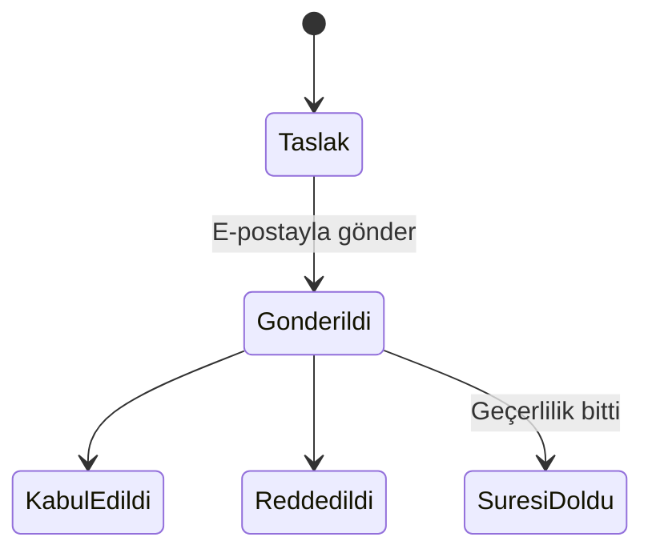
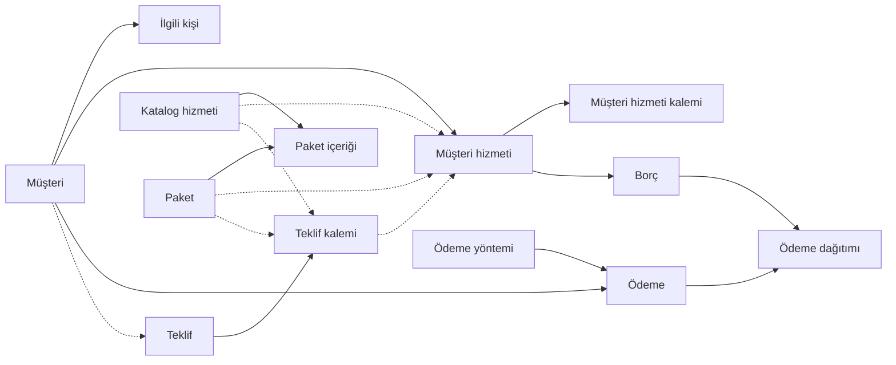

# Müşteri Takip Sistemi — Ürün Gereksinimleri (PRD)

Bu dosya iş kurallarının tek doğru kaynağıdır. Alan detayları `docs/DATA_MODEL.md`, görevler `docs/ROADMAP.md`, kararların gerekçeleri `docs/DECISIONS.md` dosyasındadır.

## Genel bakış ve tasarım ilkeleri

**En önemli ilke: Excel'den basit olmalı.** Sistemi yönetmek ayrı bir iş olmamalı. Her özellik şu testten geçer: "Bunu Excel'de yapmaktan daha kolay mı?" Geçemeyen özellik sadeleştirilir veya ertelenir.

Sistem; hosting, alan adı, bakım gibi yıllık hizmetleri müşteri bazında takip eder, teklif hazırlar, borçları otomatik oluşturur ve ödemeleri eşleştirir. Temel soru: "Bu ay kimden ne tahsil edeceğim ve kim gecikti?"

Proje tamamen Claude Code ile geliştirilecek. Çalışma kuralları `CLAUDE.md` dosyasındadır.

**Tasarım ilkeleri**

- **Esneklik:** Her müşteri farklıdır. Sistem varsayılanı önerir, kullanıcı her zaman değiştirebilir.
- **Geçmiş korunur:** Oluşmuş borçlar ve alınmış ödemeler iz bırakmadan değişmez. Değişiklikler sadece bundan sonrasını etkiler.
- **Sadelik:** Karmaşık kural motorları yerine tek net kural + elle düzenleme imkânı.
- **Katalog öneri, müşteri hizmeti gerçektir:** Katalogdaki fiyat ve bilgiler referanstır.

## Sözlük

Bu terimler proje boyunca, kodda ve dokümanlarda aynı anlamda kullanılır.

| Terim | Anlamı |
| --- | --- |
| Müşteri | Hizmet satılan kişi veya firma |
| İlgili kişi | Müşteride iletişime geçilen kişi; biri birincildir |
| Hizmet türü | Sabit liste: hosting, domain, bakım, SSL, kurumsal e-posta, lisans, diğer |
| Katalog | Panelden tanımlanan hizmet ve paketlerin listesi |
| Hosting planı | Hosting türündeki katalog kalemi (WHM package karşılığı) |
| Paket | Katalogdaki birden fazla hizmetin kendi fiyatı olan birleşimi |
| Müşteri hizmeti | Bir hizmet veya paketin bir müşteriye atanmış hali |
| Başlangıç / bitiş tarihi | Müşteri hizmetinin geçerli dönemi; yenileme borcu bitiş tarihine göre doğar |
| Teklif | Müşteriye veya potansiyel müşteriye gönderilen fiyat belgesi |
| Borç | Bir dönem için müşteriden tahsil edilecek tutar |
| Ödeme | Müşteriden gelen para |
| Ödeme yöntemi | Havale/EFT, nakit, kart gibi; panelden yönetilir |
| Alacak bakiyesi | Fazla ödemeden kalan, sonraki borçlara düşen tutar |

## Müşteriler ve ilgili kişiler

Her müşterinin benzersiz bir kısa adı ve en az bir, tam olarak bir birincil ilgili kişisi vardır.

| Alan | Zorunlu | Not |
| --- | --- | --- |
| Kısa ad | Evet | Benzersiz; listelerde görünen ad, örn. "Logi" |
| Ticari ünvan | Hayır | Örn. "Logitech Bilgisayar Ürünleri Ltd. Şti." |
| Vergi dairesi / no | Hayır | Ünvanla birlikte |
| Fatura adresi | Hayır |  |
| Notlar | Hayır | Serbest metin |

Müşteri şahıs da olabilir; bu durumda ünvan boş kalır.

**İlgili kişi alanları:** ad soyad, görev, telefon, e-posta, birincil işareti.

**Birincil kişi kuralları**

- İlk eklenen kişi otomatik birincil olur.
- Başka biri birincil yapılınca öncekinin işareti kalkar.
- Birincil kişi silinmeden önce başka biri birincil yapılmalıdır; müşteri hiçbir zaman birincil kişisiz kalmaz.
- Rol (teknik, muhasebe vb.) tutulmaz.

**Görünüm**

- **Müşteri listesi:** Her müşteri tek satır; hizmet sayısı, açık borç ve en yakın yenileme tarihiyle. Örn. "Logi · 2 hizmet · 1.900 TL açık borç · 01.03.2027".
- **Müşteri kartı:** İlgili kişiler, müşteri hizmetleri (her biri ayrı satır, tarih, fiyat ve durumuyla), borçlar, ödemeler ve alacak bakiyesi. Farklı zamanlarda satılan hizmetler ayrı satırlarda görünür.

## Hizmet türleri ve katalog

Hizmet türleri sabittir; katalog kalemleri panelden istenildiği zaman eklenir. Tüm hizmetler yıllıktır ve alış fiyatı tutulmaz.

**Ortak alanlar (katalog):** hizmet adı, tür, referans satış fiyatı, notlar.

**Türe özel alanlar** (hepsi isteğe bağlı serbest metin):

| Tür | Katalogda | Müşteri hizmetinde |
| --- | --- | --- |
| Hosting | Sağlayıcı, disk alanı, aylık trafik, e-posta hesabı sayısı, veritabanı sayısı, alan adı/site sayısı | Bağlı alan adı, sunucu, cPanel kullanıcı adı |
| Domain | Alan adı sağlayıcı, uzantı | Alan adı |
| Bakım | Kapsam açıklaması | Bağlı alan adı / site |
| SSL | Sağlayıcı, sertifika tipi | Bağlı alan adı |
| Kurumsal e-posta | Sağlayıcı, kota | Bağlı alan adı, hesap sayısı |
| Lisans | Ürün adı, sağlayıcı | Lisans anahtarı (şifreli), adet |
| Diğer | Açıklama | Açıklama |

Disk alanı gibi değerler serbest girilir: "1000 MB", "Limitsiz", "50 GB SSD". Sunucu ve cPanel kullanıcı adı şimdilik bilgi amaçlıdır; WHM entegrasyonunda eşleştirme için kullanılacak.

Veritabanında periyot ay sayısı olarak tutulur (varsayılan 12) ama arayüzde gösterilmez.

## Paketler

Paket, katalogdaki birden fazla hizmetin birleşimidir ve içindeki hizmetlerin toplamından bağımsız kendi fiyatı vardır.

- Örnek: Kurumsal Paket = Linux Hosting 1000 MB + .com.tr Alan Adı + Bakım, yıllık 4.000 TL.
- Paket fiyatı da referanstır; müşteriye atanırken değiştirilebilir.
- Paketin tek başlangıç ve bitiş tarihi vardır; içindeki hizmetler bu tarihleri kullanır ve tek borç olarak tahsil edilir.

## Müşteriye atama

Katalogdan bir hizmet veya paket müşteriye atandığında bir müşteri hizmeti oluşur; bundan sonra gerçek bilgi budur.

**Fiyat**

- Katalog fiyatı atama sırasında öneri olarak gelir, değiştirilebilir.
- Müşteri hizmetindeki fiyat sonradan da güncellenebilir.
- Katalogda fiyat değişince mevcut müşteri kayıtları etkilenmez.
- Oluşmuş borçlar hiçbir fiyat değişikliğinden etkilenmez.

**Tarihler**

- Her müşteri hizmetinde tek bir başlangıç ve bitiş tarihi vardır; ayrı tahsilat tarihi tutulmaz.
- İki tarih de elle değiştirilebilir. Değişiklik oluşmuş borcun vadesini kaydırmaz; o borcun vadesi borcun kendisinden değiştirilir.

**Ücretsiz işareti:** Müşteri hizmetinde ücretsiz işareti bulunur (bkz. Borç oluşturma).

## Teklifler

Teklifler takiplidir: katalogdaki her hizmet ve paketin yanındaki "Teklif oluştur" butonuyla hazırlanır, sistemden e-postayla gönderilir ve kabulde müşteri hizmetine dönüşür.

Teklifte elle durum yönetimi yoktur: "gönderildi" e-posta gidince, "süresi doldu" geçerlilik bitince otomatik olur. Kullanıcının tek işi kabul veya red için tek tıklamadır. Taslak teklif düzenlenebilir; gönderildikten sonra kilitlenir.

**Oluşturma**

- Alıcı mevcut müşteriden seçilir veya ad, firma, telefon, e-posta elle yazılır. Elle yazılan kişi müşteri listesine eklenmez.
- Fiyat katalogdan gelir, teklifte değiştirilebilir.
- Her teklife otomatik numara (örn. TKL-2026-0001), tarih ve geçerlilik süresi verilir (varsayılan 15 gün, ayarlardan).
- Teklif butona basılan hizmet veya paketle başlar; katalogdan başka hizmet ve paketler de eklenebilir. PDF'te kalem listesi ve toplam görünür.
- Her teklif kalemi ücretsiz işaretlenebilir; PDF'te "Ücretsiz" olarak görünür ve kabulde oluşan müşteri hizmeti de ücretsiz işaretli gelir.

**Gönderim**

- PDF ekiyle e-posta gönderilir; alıcı varsayılan olarak teklifteki veya birincil kişinin e-postasıdır, değiştirilebilir.
- Kopyası kullanıcıya BCC ile gider.
- Başarılı gönderimde durum otomatik "gönderildi" olur; tarih ve adres kaydedilir.
- Gönderilmiş teklif aynı içerikle tekrar gönderilebilir.

**Kabul**

- Mevcut müşteride hizmet veya paket doğrudan atanır.
- Elle yazılan kişi için müşteri otomatik oluşturulur: kısa ad teklifteki firma adı (firma yoksa kişinin adı) olur, teklifteki kişi birincil ilgili kişi olur. Kısa ad sonradan müşteri kartından değiştirilebilir.
- Teklif fiyatı müşteri hizmetine geçer; başlangıç tarihi varsayılan olarak kabul tarihidir, değiştirilebilir.
- Her teklif kalemi için ayrı bir müşteri hizmeti oluşur; hepsi aynı başlangıç tarihiyle başlar.

**Red:** Teklif kapanır, hiçbir kayıt oluşmaz.

## Borç oluşturma ve ücretsiz hizmetler

Her dönem için bir borç doğar; tutar müşteri hizmetindeki fiyattır. Ödeme planları bilinçli olarak kullanılmaz.

**İlk dönem:** Hizmet veya paket müşteriye atandığında (teklif kabulü dahil) ilk yılın borcu doğar.

**Excel'den geçiş:** Atama ekranında "Bu dönemin borcu" seçimi bulunur. Varsayılan "Oluştur"dur; mevcut hizmetler girilirken "Oluşturma" seçilir ve o dönem için borç doğmaz, sonraki yenilemeden itibaren kural normal işler.

**Yenileme:** Bitiş tarihinden 30 gün önce yeni dönemin borcu otomatik oluşur; vadesi bitiş tarihidir. 30 gün ayarlardan değiştirilebilir.

**Dönem ilerlemesi:** Bitiş tarihi geldiğinde kayıttaki tarihler kendiliğinden bir yıl ilerler (01.03.2026 – 01.03.2027 → 01.03.2027 – 01.03.2028). Ödeme durumu bunu etkilemez; ödenmemiş borç gecikmiş olarak takip edilir. Ücretsiz kayıtlarda da aynı şekilde ilerler.

**İptal**

- Müşteri hizmetinde "İptal et" butonu vardır; iptal tarihi ve isteğe bağlı not girilir.
- İptal edilen kayıt pasif olur: tarihleri ilerlemez, yeni borç üretmez, günlük özette görünmez. Geçmişi silinmez; gerekirse tekrar aktif edilir.
- **Henüz başlamamış dönemin ödenmemiş borcu:** İptal penceresinde "yaklaşan dönemin borcunu da iptal et" kutusu işaretli gelir; onaylanırsa iptal edilir.
- **Geçmiş dönemden kalan borç:** Hiçbir zaman otomatik iptal edilmez, takipte kalır. Pencerede bilgi olarak gösterilir (örn. "1.500 TL gecikmiş borç takipte kalacak").

**Ücretsiz hizmetler**

- Ücretsiz işaretli kayıtta borç doğmaz; hizmet ve bitiş uyarıları takip edilmeye devam eder.
- 30 gün kala günlük özette "yeni döneme ücretsiz devam edecek mi?" sorusu yer alır.
- Kullanıcı bir şey yapmazsa hizmet ücretsiz devam eder. Sistem kendiliğinden ücretliye geçmez.
- İşaret dönem başlamadan kaldırılırsa yaklaşan dönemin borcu hemen oluşur.

**Elle düzenleme:** Her borcun tutarı ve vadesi değiştirilebilir, borç bölünebilir, gerekçeyle iptal edilebilir; kurala bağlı olmayan elle borç eklenebilir. Ödemesi alınmış borç sessizce değiştirilemez; önce ödeme eşleşmesi kaldırılır veya iptal ve düzeltme kaydı yapılır.

## Ödemeler ve alacak bakiyesi

Ödeme varsayılan olarak en eski vadeli borçtan başlayarak dağıtılır; kullanıcı dağıtımı kaydetmeden önce görür ve elle değiştirebilir.

**Ödeme kaydı iki alanlıdır:** müşteri ve tutar. Tarih bugün, yöntem son kullanılan olarak gelir; açıklama isteğe bağlıdır. Dağıtım otomatik yapılır, görmek ve değiştirmek isteğe bağlıdır. Ödeme yöntemleri panelden yönetilir.

**Dağıtım örneği:** Logi'nin 1.500 TL hosting ve 400 TL alan adı borcu var, 1.000 TL gönderdi. Otomatik dağıtımda 1.000 TL hosting'e düşer, 500 TL kalır. Kullanıcı isterse önce 400 TL'yi alan adına düşebilir.

**Alacak bakiyesi**

- Açık borçları aşan tutar müşterinin alacak bakiyesine yazılır ve müşteri kartında görünür.
- Bakiye müşteri bazındadır; herhangi bir hizmetin borcuna düşebilir.
- Yeni borç doğduğunda bakiye otomatik olarak o borca düşer.
- Bakiyeden kapatılan borçlar günlük özette ayrıca belirtilir.
- Kayıt ekranı sonucu gösterir: "1.900 TL borç kapatıldı, 600 TL alacak bakiyesine eklendi."

## Para birimleri

TL, USD ve EUR desteklenir; kur çevrimi veya kur hesabı yapılmaz.

- Katalogdaki her hizmet ve paketin bir para birimi vardır, varsayılan TL.
- Müşteri hizmeti katalogdaki para birimiyle gelir, değiştirilebilir. Teklif ve PDF de bu para birimini gösterir.
- Borç, müşteri hizmetinin para biriminde doğar.
- Ödeme bir para biriminde kaydedilir ve sadece aynı para birimindeki borçlara düşer. Para birimi müşterinin açık borcundan otomatik gelir; birden fazla varsa seçilir.
- Alacak bakiyesi para birimi başına ayrı tutulur.
- Toplamlar birbirine katılmadan ayrı gösterilir: "Toplam alacak: 12.000 TL + 350 USD".

## Gecikmiş borçlar ve günlük özet e-posta

Vadesi geçip ödenmeyen borç "gecikmiş" olarak işaretlenir ve günlük özette kaç gün geciktiğiyle listelenir. Faiz, gecikme bedeli veya askıya alma yoktur; askıya alma WHM entegrasyonu fazında eklenecek.

**Günlük özet e-posta** kullanıcıya günde bir kez gider (varsayılan 09:00, ayarlardan). Bölümleri:

1. Bugün oluşan borçlar (bakiyeden kapatılanlar ayrıca belirtilir)
2. Ücretsiz devam kararı bekleyenler
3. Vadesi geçmiş borçlar

Her satırda ilgili kayda bağlantı vardır. Tüm bölümler boşsa o gün e-posta gönderilmez.

## Veri modeli

Sistem 13 tablodan oluşur; bu bölüm tabloları ve aralarındaki ilişkiyi gösterir, alan detayları ayrı sekmededir. Parantez içindeki adlar kodda kullanılacak adlardır.

Alan detayları: `docs/DATA_MODEL.md`

Düz ok "sahip olur", kesikli ok "isteğe bağlı bağlantı" demektir.

| Tablo | Kod adı | Ne tutar |
| --- | --- | --- |
| Müşteri | customers | Kısa ad, ünvan, vergi ve adres bilgileri |
| İlgili kişi | contacts | Müşterinin kişileri; biri birincil |
| Katalog hizmeti | catalog\_services | Tür, ad, referans fiyat, para birimi, türe özel bilgiler |
| Paket | packages | Ad, kendi fiyatı, para birimi |
| Paket içeriği | package\_items | Hangi paketin içinde hangi katalog hizmetleri var |
| Müşteri hizmeti | customer\_services | Müşteriye satılan hizmet veya paket: fiyat, para birimi, başlangıç/bitiş, ücretsiz, durum, iptal bilgisi |
| Müşteri hizmeti kalemi | customer\_service\_items | Müşteriye özel bilgiler: alan adı, sunucu, cPanel kullanıcı adı, lisans anahtarı vb. Pakette her iç hizmet için bir kalem |
| Teklif | quotes | Numara, alıcı (müşteri veya elle yazılan kişi), durum, tarihler, gönderim bilgisi |
| Teklif kalemi | quote\_items | Teklifteki her hizmet veya paket: ad, fiyat, para birimi, ücretsiz işareti |
| Borç | charges | Müşteri hizmeti (elle borçta boş), tutar, para birimi, vade, dönem, durum |
| Ödeme | payments | Müşteri, tutar, para birimi, tarih, yöntem, açıklama |
| Ödeme dağıtımı | payment\_allocations | Hangi ödemenin ne kadarı hangi borca düştü |
| Ödeme yöntemi | payment\_methods | Havale/EFT, nakit, kart gibi |

Ayrıca ayarlar (30 gün, özet saati, teklif geçerliliği, BCC adresi) ve Laravel'in kendi kullanıcı tablosu bulunur.

**Bilinçli tasarım seçimleri**

- **Alacak bakiyesi ayrı tabloda tutulmaz;** ödemeler ile dağıtımların farkından, para birimi başına hesaplanır. Böylece bakiye hiçbir zaman kayıtlarla çelişemez.
- **Türe özel bilgiler tek esnek alanda tutulur.** Disk alanı, sağlayıcı gibi bilgilerin hepsi serbest metin olduğu için her türe ayrı tablo açmak yerine tek alanda saklanır; hangi türün hangi bilgileri alacağı kodda tanımlanır.
- **Müşteri hizmeti satış anının kopyasını tutar.** Ad, fiyat ve para birimi katalogdan kopyalanır; katalog değişse de müşteri hizmeti etkilenmez.

**Silme ve arşiv**

- Hiç borcu veya ödemesi olmayan kayıtlar gerçekten silinebilir.
- Borcu veya ödemesi olan kayıtlar silinmez, arşivlenir: listelerden ve günlük özetten kaybolur, geçmişiyle sistemde durur, arşivden geri alınabilir. Müşteri hizmetlerinde bunun karşılığı iptaldir.
- Yanlış girilmiş ödeme silinebilir; dağıtımları geri alınır ve kapattığı borçlar tekrar açık hale gelir.

## Teknik kararlar ve Claude Code ile çalışma

Proje Laravel 13 ve PHP 8.3+ ile, tamamen Claude Code tarafından geliştirilecek.

| Konu | Karar | Durum |
| --- | --- | --- |
| Framework | Laravel 13 (Laravel 11 güvenlik desteği Mart 2026'da bitti) | Kararlaştı |
| PHP | 8.3 veya üzeri; sunucuda kontrol edilecek | Kararlaştı |
| Arayüz | Filament 5 (hazır tablo, form ve panel bileşenleri; ileride müşteri paneli için ikinci panel) | Kararlaştı |
| Model stili | PHP Attribute'ları; tüm projede tek stil | Kararlaştı |
| Tutarlar | Kuruş cinsinden tam sayı; float kullanılmaz | Kararlaştı |
| Sabit listeler | PHP backed enum | Kararlaştı |
| Test ve kalite | Pest, Pint, Larastan, GitHub Actions | Kararlaştı |
| AI araçları | Laravel Boost (sürüme özel dokümantasyon) | Kararlaştı |
| Hassas veri | Lisans anahtarı şifreli saklanır | Kararlaştı |
| Veritabanı | MySQL 8.0 (hostingde 8.0.45); yerelde Docker'da da MySQL 8.0 sabitlenir; karakter seti utf8mb4, kod MySQL 8.4 ile de uyumlu kalır | Kararlaştı |
| PDF, kuyruk, zamanlayıcı | Reseller hosting (cPanel), cron en sık 15 dakikada bir: PDF için dompdf (saf PHP, Türkçe için DejaVu font); kuyruk yok, teklif e-postası anında gönderilir; zamanlayıcı */15 cron ile çalışır ve görevler tekrar çalışmaya dayanıklıdır; Redis yok, önbellek ve oturum database/dosya | Kararlaştı |
| E-posta gönderimi | cPanel e-posta hesabı SMTP (örn. teklif@firmaniz.com), kuyruksuz anında gönderim; alan adında SPF ve DKIM açık olmalı | Kararlaştı |

**Karar yetkisi:** Sadece kodun içini ilgilendiren ve işleyişe etkisi olmayan kararları Claude verir ve gerekçesiyle kaydeder; işe veya altyapıya dokunan kararlar kullanıcıya sorulur.

**Yayına alma (SSH ve Composer yok, PHP 8.3 seçilebilir)**

- Kod GitHub'da tutulur. Her yayın için GitHub Actions testleri çalıştırır, Composer bağımlılıklarını (`vendor`) ve arayüz dosyalarını hazırlar, hazır paketi FTPS ile hostinge yükler. Sunucuda Composer gerekmez.
- Yükleme bitince GitHub Actions, gizli anahtarla korunan bir yayın adresini çağırır; bu adres veritabanı güncellemelerini (migration) ve önbellek yenilemeyi hemen çalıştırır. 15 dakikalık cron yedek olarak aynı kontrolü yapar. SSH gerekmez.
- Cron 15 dakikada bir çalıştığı için zamanlanmış işler "tam dakikada çalış" yerine "henüz yapılmadıysa yap" mantığıyla yazılır: borç oluşturma ve dönem ilerletme her çalışmada kontrol edilir, günlük özet ayarlanan saatten sonraki ilk çalışmada bir kez gönderilir. Atlanan bir cron çalışması hiçbir işi kaybettirmez.
- İlk kurulumda elle yapılacaklar: cPanel'de PHP 8.3 seçmek, veritabanı açmak, alan adının kök dizinini projenin `public` klasörüne yönlendirmek, `.env` dosyasını Dosya Yöneticisi'nden oluşturmak, */15 cron görevini eklemek. Bunlar için adım adım kurulum rehberi yazılacak.

**Yerel geliştirme (Windows + Docker)**

- Ubuntu/WSL2 kullanılmaz; proje Windows klasöründe durur, Claude Code Windows'ta (Git Bash ile) çalışır.
- Ortam projeye ait bir Docker Compose dosyasıyla kurulur: PHP 8.3 uygulama konteyneri, MySQL 8.0, Mailpit. Sail kullanılmaz.
- Tüm PHP, Composer, Artisan ve test komutları konteyner içinde çalışır (`docker compose exec app ...`). Windows'ta kurulu PHP ve Composer bu projede kullanılmaz.
- Hız için `vendor` ve `node_modules` Docker'ın kendi birimlerinde (volume) tutulur.
- Satır sonları her yerde LF: `.gitattributes` ve Git ayarıyla sabitlenir.
- `composer.json` içinde platform PHP 8.3; testler ayrı bir test veritabanında çalışır; e-postalar yerelde Mailpit ile yakalanır.

**Repodaki doküman seti:** `CLAUDE.md` (kurallar, komutlar, sürüm), `docs/PRD.md`, `docs/DATA_MODEL.md`, `docs/ROADMAP.md`, `docs/DECISIONS.md`.

**Çalışma döngüsü**

- Her görev tek oturumda biter; bağımlılıkları ve kabul kriterleri yazılıdır.
- Kabul kriterleri Pest testleri olarak yazılır.
- Plan modunda onay → uygulama → testler geçer → commit → ROADMAP güncellenir → `/clear`.
- İş mantığı arayüzden önce, testleriyle birlikte yapılır.

## MVP kapsamı ve yol haritası

MVP, Excel'i bırakıp sistemi günlük kullanmaya başlamayı sağlayan en küçük sürümdür; teklifler MVP'nin hemen ardından ilk ek olarak gelir.

**MVP'de olanlar**

- Müşteriler ve ilgili kişiler, arşiv
- Katalog: hizmetler, hosting planları, paketler
- Müşteri hizmeti atama, ücretsiz işareti, iptal
- Otomatik borç oluşturma, dönem ilerletme, borçları elle düzenleme
- Ödeme kaydı, otomatik dağıtım, alacak bakiyesi
- Para birimleri
- Müşteri listesi, müşteri kartı ve ana panel (yaklaşan yenilemeler, gecikmiş borçlar, toplam alacak)
- Günlük özet e-postası
- Ayarlar, kurulum rehberi ve otomatik yayına alma

Toplu Excel içe aktarma yoktur; mevcut kayıtlar ekranlardan elle girilir ("Bu dönemin borcu: Oluşturma" seçeneğiyle).

**Yol haritası**

| Faz | İçerik |
| --- | --- |
| 0 – Planlama | Bu doküman, görev listesi, CLAUDE.md |
| 1 – İskelet | Docker ortamı, Laravel 13, Filament 5, Pest/Pint/Larastan, Laravel Boost, CLAUDE.md ve docs, GitHub Actions ile otomatik test, hosting uyumluluk kontrolü |
| 2 – Veri katmanı | Migration'lar, modeller, enum'lar, factory'ler, örnek veri, model testleri |
| 3 – İş mantığı | Borç oluşturma, dönem ilerletme, iptal, ödeme dağıtımı, alacak bakiyesi, zamanlanmış görevler; hepsi testli |
| 4 – Arayüz | Filament ekranları: müşteriler, katalog, müşteri hizmetleri, borçlar, ödemeler, ayarlar |
| 5 – Yayına alma, panel ve MVP kapanışı | Otomatik yayına alma ve kurulum rehberi, ana panel, günlük özet e-postası, uçtan uca testler, canlıya geçiş |
| 6 – Teklifler | Teklif, kalemler, PDF, e-posta gönderimi, kabulde otomatik müşteri ve hizmet |
| 7 – İz ve esneklik | Fiyat/tarih değişiklik geçmişi, %50 ön ödeme kuralı |
| 8 ve sonrası | Raporlar, müşteri paneli, WHM API/UAPI entegrasyonu |

Yayına alma Faz 5'in başında kurulur; Faz 4'ten önce canlıda kullanılacak bir şey olmadığı için ilk fazlar ürüne odaklanır. Hosting kaynaklı sürprizleri önlemek için Faz 1'de hosting uyumluluk kontrolü yapılır ve yerel ortam hostingle aynı PHP ve MySQL sürümüne sabitlenir.

Fazların görevlere bölünmüş hali: `docs/ROADMAP.md`

## Park edilenler (MVP sonrası)

- Web sitesi işi için %50 kabulde, %50 iş bitiminde kuralı
- Fiyat ve tarih değişikliklerinin geçmişi
- WHM API ve UAPI entegrasyonu: kota, bant genişliği kontrolü, askıya alma
- Müşteri paneli, raporlar ve grafikler
